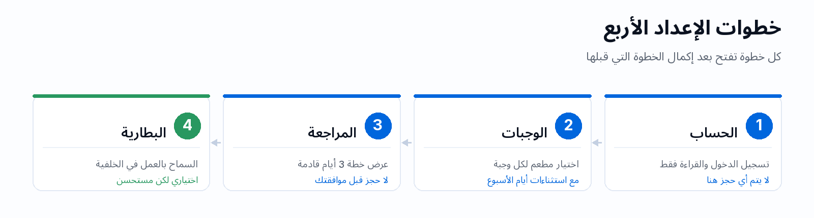
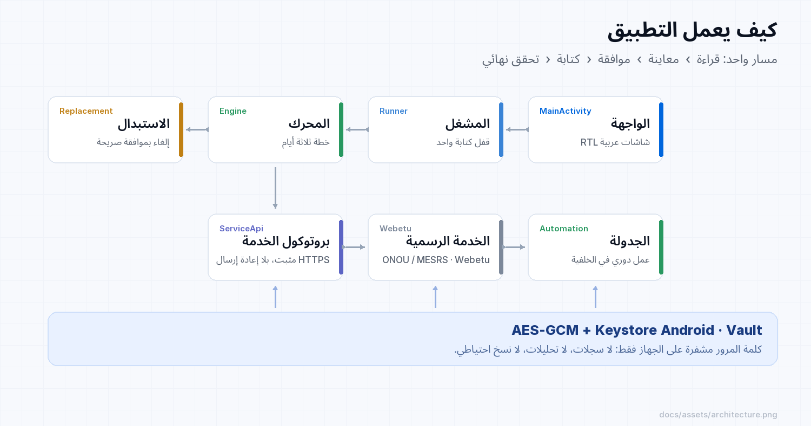

<div align="center">


# Wajabati · وجباتي

**عميل أندرويد شخصي لحجز الوجبات الجامعية على Webetu · 0.13.1**
**A personal Android client for university meal reservations on Webetu · 0.13.1**

[](https://github.com/Ahmed47-t/Wajabati/releases)
[](app/src/test/java/dz/local/mealguard)
[](docs/validation/lint-0.13.0.txt)
[](https://developer.android.com/about/versions/oreo)
[](app/build.gradle)
[](docs/USER_GUIDE_AR.md#7-الخصوصية)
[](#الحدود-والتحذيرات)


</div>

> [!WARNING]
> **ليست نسخة متجر، ولا منتجًا رسميًا، ولا تابعة لوزارة التعليم العالي (MESRS) أو الديوان الوطني للخدمات الجامعية (ONOU).**
> تطبيق شخصي تجريبي، مكتوب لاستخدام صاحبه. لم يُختبر بحساب حقيقي ولا على جهاز فعلي، والـAPK موقّع بمفتاح تطوير.
> استعمله فقط إن كانت شروط الخدمة تسمح بذلك؛ ولا يوجد فيه أي تجاوز لـCAPTCHA أو التحقق بخطوتين أو صلاحيات الوصول أو نافذة الحجز.

## المحتويات

- [نظرة سريعة](#نظرة-سريعة)
- [مسار الإعداد](#مسار-الإعداد)
- [كيف يعمل](#كيف-يعمل)
- [ما الذي يفعله](#ما-الذي-يفعله)
- [التثبيت والبناء](#التثبيت-والبناء)
- [البنية التقنية](#البنية-التقنية)
- [الخصوصية والأمان](#الخصوصية-والأمان)
- [سجلّ الإصدارات](#سجلّ-الإصدارات)
- [الحدود والتحذيرات](#الحدود-والتحذيرات)
- [الملفات المرفقة](#الملفات-المرفقة)
- [المساهمة والترخيص](#المساهمة-والترخيص)
- [English summary](#english-summary)

---

## نظرة سريعة

وجباتي تطبيق أندرويد أصلي (Java، بلا مكتبات واجهة خارجية) يقرأ حجوزاتك على Webetu **قراءةً فقط**، يعرض خطتك للأيام الثلاثة القادمة، ولا يرسل أي حجز قبل أن ترى الخطة وتوافق عليها بنفسك.

| البند | التفصيل |
|---|---|
| اسم التطبيق | `Wajabati` · سطر الإصدار `0.13.1` |
| الإصدار الحالي | `0.13.1` · versionCode 15 |
| المنصّة | Android 8.0 (API 26) فما فوق · targetSdk 35 |
| اللغة | Java 17 · بلا Kotlin · بلا مكتبات واجهة خارجية |
| الواجهة | عربي افتراضيًا (RTL كامل) + فرنسي (تجريبي) + فاتح/داكن/حسب النظام |
| التشفير | Android Keystore · AES-GCM · لا نص واضح ولا نسخ احتياطي |
| الخادم | لا خادم وسيط: الاتصال يذهب مباشرة إلى MESRS/ONOU |
| التتبّع | لا تحليلات، لا إعلانات، لا تتبّع، لا تحديث تلقائي |
| الاختبارات | 226 اختبارًا محليًا ناجحًا (Robolectric على API 28/35) |

### المبدأ في سطر واحد

> **لا كتابة قبل قراءة، ولا إرسال قبل موافقة، ولا إعادة إرسال عند الشك.**

---

## مسار الإعداد

<div align="center">

</div>

كل خطوة تُفتح بعد التي قبلها. خطوة الحساب لا ترسل حجزًا، والوجبات كلها اختيارية، والكتابة تحتاج موافقتك، والبطارية ليست شرطًا للحجز.

<details>
<summary><b>كيف أحصل على لقطات شاشة حقيقية من الكود؟</b></summary>

الشاشات تُرسم فعليًا (Robolectric + رسوميات أصلية) وتُحفظ PNG عند الطلب — لا صور مركّبة في هذا المستودع:

```sh
mkdir -p shots
MEALGUARD_SHOTS=$PWD/shots ./gradlew :app:testReleaseUnitTest --tests '*ScreenshotTest'
```

تُنتَج أربع مجموعات: `light-`، `dark-`، `large-` (خط 1.6×)، و`fr-` (فرنسي)، وتشمل الرئيسية، الدخول، الإعدادات، حالة الانشغال، التبويبات، ورقة الاختيار، والمراجعة.

</details>

---

## كيف يعمل

<div align="center">

</div>

1. **قراءة** — دخول إلى Webetu وقراءة السنة الجامعية والإقامة والمطاعم والحجوزات الحالية، بلا كتابة.
2. **معاينة** — بناء خطة الأيام الثلاثة القادمة ومقارنتها بالحجوزات القائمة، وكشف التعارضات بالاسم والمعرّف.
3. **موافقة** — تراجع الخطة ورسالة التأكيد؛ لا يُرسل شيء قبل ذلك.
4. **كتابة** — طلب واحد لكل وجبة ناقصة، مع قفل يوم/وجبة في سجل مشفّر **قبل** الإرسال.
5. **تحقّق** — قراءة نهائية كاملة لكل الحجوزات؛ عند أي شك يتوقّف التنفيذ ولا يعيد المحاولة.

---

## ما الذي يفعله

| المجال | التفصيل |
|---|---|
| التخزين | كلمة المرور مشفّرة على الجهاز بمفتاح داخل Android Keystore (AES-GCM)؛ لا خادم وسيط ولا رفع بيانات خارج MESRS/ONOU؛ لا سجلات ولا تحليلات؛ `allowBackup=false` |
| الكتابة | قراءة ثم معاينة ثم موافقة صريحة؛ سجل محاولات يمنع الإرسال المكرّر عند الاستجابة الغامضة؛ عند الالتباس يتوقّف ويشرح مسار الإصلاح؛ القفل يخصّ وجبته وحدها فتُكمل بقية الخطة |
| الخطة | فطور/غداء/عشاء مستقلة بأي مزيج وبأي مطعم متاح للحساب؛ استثناءات أسبوعية لكل يوم تُضيف وجبة ليوم واحد أو تتخطّاها؛ الوجبة الفارغة يتخطّاها التطبيق كليًا |
| الجدولة | WorkManager بقيود شبكة وفترات من 15 دقيقة إلى 48 ساعة؛ إشعار مستمر بحالة الجدولة وإشعار نتيجة لكل عملية؛ فحص فوري عند عودة الشبكة أثناء حياة العملية؛ أقفال الأيام الخارجة من نافذة الحجز تُلغى تلقائيًا |
| الواجهة | عربي RTL افتراضيًا بلا اعتماد على لغة الهاتف، وفرنسي اختياري؛ فاتح/داكن/حسب النظام؛ أحجام خطوط حتى 1.6×؛ تسميات لقارئ الشاشة؛ أيقونة تكيّفية تعمل مع كل الأقنعة |
| الاستبدال | موافقة صريحة ثانية تعرض ما سيُلغى؛ لا إلغاء تلقائي من الخلفية؛ لا تراجع تلقائي بعد إلغاء فاشل |

---

## التثبيت والبناء

### للاستخدام

1. نزّل الـAPK من صفحة [الإصدارات](https://github.com/Ahmed47-t/Wajabati/releases).
2. ثبّته على أندرويد 8.0 فما فوق (اسمح بالتثبيت من هذا المصدر إن طُلب ذلك).
3. افتح التطبيق: يظهر في المشغّل باسم **Wajabati** وتحته `0.13.1`. الأتمتة **متوقّفة افتراضيًا** حتى تُعدّ الحساب وتراجع الخطة.

> [!IMPORTANT]
> الـAPK موقّع **بمفتاح تطوير (debug)**، لذا لا يمكنه تحديث تثبيت سابق موقّع بمفتاح مختلف، ولا يصلح للنشر في متجر.

### البناء من المصدر

المتطلّبات: JDK 17، Android SDK platform 35 + build-tools، ووصول إلى الشبكة لجلب تبعيات Gradle المثبّتة.

```sh
# Linux / macOS
chmod +x gradlew
export ANDROID_HOME=/path/to/android-sdk       # أو أنشئ local.properties غير متعقّب
./gradlew --no-daemon :app:testReleaseUnitTest :app:lintRelease :app:assembleRelease
```

```bat
:: Windows
gradlew.bat --no-daemon :app:testReleaseUnitTest :app:lintRelease :app:assembleRelease
```

الناتج: `app/build/outputs/apk/release/app-release.apk`

<details>
<summary><b>لقطات الشاشة الاختيارية وتشغيل اختبار واحد</b></summary>

```sh
# صور PNG حقيقية للشاشات (فاتح/داكن/خط كبير/فرنسي)
mkdir -p shots && MEALGUARD_SHOTS=$PWD/shots ./gradlew :app:testReleaseUnitTest --tests '*ScreenshotTest'

# اختبار محدّد
./gradlew :app:testReleaseUnitTest --tests 'dz.local.mealguard.EngineTest'
```

</details>

---

## البنية التقنية

| الملف | المسؤولية |
|---|---|
| `MainActivity` | الواجهة العربية الأصلية، المعاينة، الموافقة اليدوية، والأتمتة المتوقّفة افتراضيًا |
| `Vault` | Keystore AES-GCM، مصادَق باسم السجل، بلا بديل نصّي ولا نسخ |
| `ServiceApi` | نقاط HTTPS مثبّتة، تحقّق شهادات النظام، قراءات محدودة وأخطاء مُطهّرة |
| `Engine` · `WeeklySchedule` | خطة ثلاثة أيام، استثناءات أسبوعية، وسجل كتابة/تحقّق متحفّظ |
| `Runner` | قفل كتابة داخل العملية، وقراءات حديثة للحساب والمطاعم والحجوزات |
| `Replacement` | آلة حالة استبدال بموافقة صريحة، وتحقّق قبل/بعد |
| `Automation` · `SyncPolicy` | WorkManager دوري بقيود شبكة، تراجع محدود، وإشعارات حالة |
| `Appearance` · `ChoiceField` · `PillToggle` | لوحات ألوان، حقول اختيار، ومفتاح متحرّك أصلي |

> [!NOTE]
> `ServiceApi` محوّل توافق لما لوحظ من طلبات، وليس SDK رسميًا. قد يحتاج تعديلًا إذا غيّرت الخدمة بروتوكولها.

---

## الخصوصية والأمان

| يفعله التطبيق | لا يفعله |
|---|---|
| يشفّر كلمة المرور محليًا داخل Keystore | لا يرسل بياناتك إلى أي خادم وسيط |
| يتحقّق من شهادات TLS الافتراضية | لا يتجاهل أخطاء الشهادات ولا يتبع تحويلات |
| يمنع النسخ الاحتياطي عبر `allowBackup` | لا يسجّل كلمة المرور أو الرموز |
| يقرأ فقط قبل الموافقة | لا يجمع تحليلات ولا معرّفات إعلانية |
| يوقف الإرسال عند أي التباس | لا يكرّر كتابة لم تُؤكَّد نتيجتها |

المشروع لا يحتوي على مفاتيح توقيع ولا بيانات اعتماد. كلمات المرور تُدخَل وقت التشغيل فقط.

---

## سجلّ الإصدارات

<details open>
<summary><b>0.13.1 — الوجبات الاختيارية والاستثناء الأسبوعي الموجب</b></summary>

- المطاعم الثلاثة لم تعد شرطًا: الوجبة الفارغة («لا حجز لهذه الوجبة») يتخطّاها التطبيق في الخطة والحجز والتحقّق والتذكيرات.
- الاستثناءات الأسبوعية تستطيع إضافة مطعم لوجبة غير مُعدّة في ذلك اليوم فقط (فطور الجمعة مثلًا)، أو تخطّي وجبة مُعدّة.
- اسم التطبيق في المشغّل صار `Wajabati` وحدَه (بدل `وجباتي` الطويل)، وسطر `0.13.1` تحته، وشاشة «حول» تعرض الرقم نفسه.
- شعار وأيقونة تكيّفية جديدان، وبانرات الـREADME تولَّد من `docs/assets/generate.py`.
- 226 اختبارًا محليًا ناجحًا · 0 فشل.

</details>

<details>
<summary><b>0.13.0 — استرداد الحجوزات العالقة وتنظيف التدقيق</b></summary>

- قفل المحاولة المعلّقة يحجز وجبته وحدها؛ الوجبات الأخرى تُحجز وتُتحقّق.
- أقفال انتهت مدة صلاحيتها تُلغى تلقائيًا، وسجل المحاولات يسجّل الوقت والسبب.
- قراءة حالة اليوم من الكاش الحقيقي، وتنقية أسماء المطاعم من علامات الشطب.
- إزالة كود ميت وتوحيد منطق مكرّر.

</details>

<details>
<summary><b>0.12.0 · 0.11.0 · 0.10.0 · 0.9.0 وما قبلها</b></summary>

- **0.12.0** — حقل كلمة المرور وحده في صندوق واحد مع زر الإظهار، وطلب استثناء البطارية مباشرة.
- **0.11.0** — الاستثناءات الأسبوعية داخل الخطوة الثانية، تسجيل دخول أقصر، بلا حوارات تأكيد للحجز والتفعيل، والبطارية خطوة رابعة.
- **0.10.0** — شاشات مبنية على mockup: بطاقة تقدّم، قائمة إعداد ثلاثية، تبويب حجوزات للقراءة فقط.
- **0.9.0** — تنقّل سفلي بثلاثة مقاصد، `ChoiceField` بدل `Spinner`، أزرار أساسية مثبّتة فوق لوحة المفاتيح، وترجمة فرنسية.
- **0.8.0** — إصلاحات تدقيق UX: زر الرجوع داخل الإعداد، شريط تقدّم مثبّت، أخطاء بجانب مصدرها، وتباين أوضح.
- **0.7.0** — استبدال حجز بموافقة صريحة (إلغاء ثم إعادة حجز، بلا تراجع تلقائي).
- **0.4.0 – 0.6.0** — حساب عام بدل أسماء مطاعم مثبّتة، مظهر دائم، فترات حتى 48 ساعة، وصفحة «حول».
- **0.1.0 – 0.3.0** — الأساس: قراءة فقط، معاينة، حجز يدوي، وجدولة بـWorkManager.

</details>

---

## الحدود والتحذيرات

> [!CAUTION]
> - **لا يعمل الحجز التلقائي والهاتف مغلق أو بلا إنترنت.** لا توجد خدمة أمامية دائمة ولا منبّهات دقيقة.
> - **الجدولة أفضل جهد**: قيود النظام قد تؤخّر العمل أو الإشعارات.
> - **الاستبدال ليس تبديلًا ذرّيًا**: قد يُلغى الحجز القديم ثم يفشل الجديد، فتبقى بلا حجز.
> - **إيقاف الأتمتة لا يلغي حجزًا أُرسل بالفعل.**
> - **لا تستعمله على حساب لا تملكه**، ولا تعتمد عليه قبل اختبار الدخول والمعاينة والحجز والتحقّق في Webetu الرسمي.
> - **لم يُبنَ هذا الإصدار من الشيفرة في هذه البيئة**، وما على صفحة الإصدارات من ملفات لا يطابق الشيفرة الحالية؛ راجع قسم [الملفات المرفقة](#الملفات-المرفقة).

---

## الملفات المرفقة

| الإصدار | الملف | مطابقة الشيفرة |
|---|---|---|
| `v0.13.1` | `MealGuard-0.13.1-weekly-positive-exceptions.apk` (2.0 MB) | **لا.** بُني قبل هذه المراجعة: اسم التطبيق فيه `وجباتي`، وبلا شعار الـREADME الجديد. بصمته عند النشر: `a11c8d32a5b9f1fca768f8d181bd0f063037bc95643b4a6445e4f6dd02bfea44` |

**لم يُنتَج ملف APK جديد في هذه المراجعة.** بناء أندرويد يحتاج JDK 17 وAndroid SDK 35، وهما غير متوفّرين في بيئة العمل التي أُجريت فيها التعديلات، فالملف المنشور أعلاه لا يحتوي تغييرات الاسم والشعار.

لتوليد ملف مطابق للشيفرة الحالية على جهازك:

```sh
./tools/release.sh            # فحص تناسق الإصدار + tests + lint + assemble + بصمة SHA-256
./tools/release.sh --publish  # نفس ما سبق + إنشاء إصدار GitHub ورفع Wajabati-0.13.1.apk
```

أو يدويًا:

```sh
./gradlew --no-daemon :app:assembleRelease
sha256sum app/build/outputs/apk/release/app-release.apk
gh release upload v0.13.1 app/build/outputs/apk/release/app-release.apk
```

> [!IMPORTANT]
> الملف يُوقَّع بمفتاح debug المحلي (كما في `app/build.gradle`). مفتاح جهاز آخر مختلف، لذا لا يمكن تثبيت النسخة الجديدة فوق نسخة سابقة موقّعة بمفتاح آخر: يجب إزالة التثبيت القديم أولًا.

---

## المساهمة والترخيص

- هذا مشروع **شخصي غير مفتوح للترخيص العام**: الكود منشور للاطّلاع والمراجعة، ولا يُمنح ترخيص صريح لإعادة التوزيع أو النشر التجاري.
- لا تُرفع أي بيانات حساب أو كلمات مرور أو رموز جلسات في Issues أو Pull Requests.
- عند الإبلاغ عن خطأ: أرفق نص الخطأ المُطهّر (S01–S10) وإصدار أندرويد، بلا أي بيانات شخصية.

---

<div dir="auto">

## English summary

**Wajabati** (وجباتي) is a personal, experimental Android client for university meal reservations on Algeria's Webetu platform. Written in plain Java 17 with no UI frameworks, it reads your existing reservations, shows a three-day plan, and then — only after your explicit approval — books whatever is missing.

- **Read → preview → approve → write → verify.** Nothing is booked without consent, and no write is ever retried when the result is uncertain.
- **Privacy by design.** The password is encrypted with Android Keystore / AES-GCM on-device, there is no middleman server, no telemetry, and no backup of credentials.
- **Not official.** Not affiliated with MESRS or ONOU, not a store release, not tested with a live account or on a physical device, and not a substitute for the official app.
- **Local verification.** 226 unit/UI tests (JUnit + Robolectric on API 28/35) and Android lint with 0 errors; see [`lint-0.13.0.txt`](docs/validation/lint-0.13.0.txt).

Build: `./gradlew --no-daemon :app:testReleaseUnitTest :app:lintRelease :app:assembleRelease` (JDK 17 + Android SDK 35).

</div>

<div align="center">
<br>
<sub>© 2026 TFYCHE AHMED REDOUANE · مشروع شخصي غير تابع لأي جهة رسمية</sub><br>
<sub><a href="docs/USER_GUIDE_AR.md">دليل الاستخدام</a> · <a href="docs/USABILITY_TEST_AR.md">بروتوكول اختبار الاستخدام</a> · <a href="https://github.com/Ahmed47-t/Wajabati/releases">الإصدارات</a></sub>
</div>
